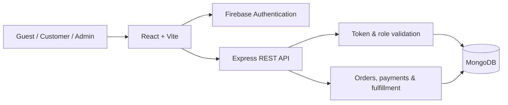

<div align="center">

# 🎁 SokhBilash (শখবিলাস)

### A Bengali-first gift e-commerce platform for Bangladesh

**Personalized gifts · Guest checkout · Manual payment verification · Order management**

[](https://react.dev/)
[](https://vite.dev/)
[](https://tailwindcss.com/)
[](https://nodejs.org/)
[](https://www.mongodb.com/)
[](https://firebase.google.com/)

[Features](#-key-features) · [Architecture](#-architecture) · [Business Logic](#-business-logic) · [Setup](#-getting-started)

</div>

---

## 📖 Overview

**SokhBilash** is a mobile-first gift shopping platform designed for Bangla-speaking customers. It supports product discovery, customizable gifts, guest and registered-user checkout, and an admin dashboard for managing products, orders, payments, and deliveries.

The application uses a **React storefront** connected to a separately deployable **Express REST API**, with **Firebase Authentication** and **MongoDB** for identity and business data.

## 🖼️ Screenshot


*Actual development screenshot of a responsive storefront section.*

## ✨ Key Features

| Area | Features |
| --- | --- |
| **Product discovery** | Bangla, English & Banglish-aware search; categories, occasions, filters, sorting, and pagination |
| **Product catalog** | Multiple images, variants (size/color/type), discounts, availability, and optional personalization |
| **Cart & wishlist** | Guest cart, signed-in cart, cart merge after login, wishlist, and item customization |
| **Checkout** | Guest/customer orders, delivery details, gift wrapping, personal messages, and server-calculated totals |
| **Payments** | bKash, Nagad & Rocket **manual Send Money** submissions; Cash on Delivery (COD) |
| **Customer account** | Firebase login, profile management, order history, and order tracking |
| **Admin dashboard** | Product management, customer directory, payment review, order processing, and delivery tracking |

> **Payment note:** MFS payments are **manually reviewed** against submitted sender details and transaction references. There is no automated merchant payment gateway integration.

## 🧰 Tech Stack

| Layer | Technologies |
| --- | --- |
| **Frontend** | React, Vite, React Router, Tailwind CSS v4, DaisyUI, Lucide React |
| **Data fetching** | TanStack React Query, Axios / Fetch API |
| **Backend** | Node.js, Express.js (separate service) |
| **Database** | MongoDB with Native Driver (no Mongoose) |
| **Authentication** | Firebase Authentication + Firebase Admin SDK |

## 🏗️ Architecture



**Responsibility split:** React manages the interface and client interactions; Firebase authenticates users; Express validates requests, recalculates pricing, and enforces roles; MongoDB stores the catalog, carts, orders, and customer records.

## 📂 Project Organization

The frontend follows a **feature-based page structure**:

```text
src/
├── components/        # Reusable UI and product components
├── layouts/           # Public, auth, and admin layouts
├── pages/
│   ├── Home.jsx       # Landing page
│   ├── shop/          # Catalog, categories, product details
│   ├── cart/          # Cart, wishlist, checkout
│   ├── customer/      # Profile and order history
│   ├── orders/        # Order status and tracking
│   ├── auth/          # Authentication pages
│   ├── admin/         # Admin operations
│   ├── information/   # Help and policies
│   ├── error/         # Error pages
│   └── general/       # General-purpose pages
├── providers/         # Shared app/auth state
├── routes/            # Routing and access guards
└── utils/             # API helpers and site configuration
```

*Directory overview reflects the feature-based organization; individual filenames may vary by revision.*

## 🧩 Business Logic

### Shopping & personalization

- Catalog queries combine search, taxonomy, feature, price, and availability filters with server-side pagination.
- Products may contain multiple variants with their own SKU, price, image, and availability; eligible products accept custom text or image references.
- Guest carts can be merged into a customer account on sign-in, with protections against replaying the same merge request.

### Checkout & delivery

- The backend loads current product data, validates selected variants, and **calculates the final total** rather than trusting prices sent by the browser.
- Delivery fees: **৳80 within Narsingdi** and **৳130 elsewhere in Bangladesh**. Optional gift wrapping adds **৳50**.
- Orders support customer/guest checkout, unique order identifiers, and restricted access to sensitive order information.

### Payment & fulfillment

1. The customer places an order with **bKash / Nagad / Rocket transaction details** or selects **COD**.
2. An admin manually **verifies or rejects** payment evidence; COD orders use phone confirmation. Payment status and outstanding amounts are tracked.
3. Authorized staff manage the order through **pending → verified → processing → shipped → delivered**, with tracking details and history.
4. Customers can review their own orders; limited public tracking requires the **order reference and matching phone number**.

### Security

- Firebase ID tokens are verified by the backend; admin routes also require an **active admin role** stored in MongoDB.
- Product prices and cart configurations are checked on the server. Duplicate transaction references and repeated checkout submissions are guarded against.
- Admin accounts cannot place customer orders. Guest access to private order details requires a server-issued access token.

## 🔌 API Highlights

| Module | Example endpoints |
| --- | --- |
| **Catalog** | `GET /products`, `GET /products/:identifier`, `GET /categories`, `GET /occasions` |
| **Cart** | `GET /cart`, `POST /cart/items`, `POST /cart/merge` |
| **Checkout** | `POST /checkout/quote`, `POST /orders` |
| **Orders** | `GET /orders/my`, `POST /orders/public/track` |
| **Admin** | `/admin/products`, `/admin/orders`, `/admin/payments`, `/admin/deliveries` |

*Backend endpoints are implemented in the separately maintained Express service.*

## 🚀 Getting Started

**Requirements:** Node.js LTS, npm, a Firebase project with Email/Password authentication, and the running Express/MongoDB API.

```bash
git clone https://github.com/nknilandu/sokh-bilash.git
cd sokh-bilash
npm install
npm run dev
```

Create an untracked **`.env.local`** file and configure the public frontend settings:

```dotenv
VITE_API_URL=http://localhost:3000
VITE_CONTACT_PHONE=+8801XXXXXXXXX
VITE_WHATSAPP_NUMBER=8801XXXXXXXXX
VITE_CONTACT_EMAIL=contact@example.com
```

Set up the Firebase web client in the project's Firebase configuration. Run the **backend separately**, using its own MongoDB credentials, Firebase Admin service account, and server-side secrets.

```bash
npm run build
```

> **Never commit** `.env` files, service-account JSON, database passwords, or private access tokens. Vite's `VITE_*` variables are embedded in the public client bundle.

## 👨‍💻 Maintainer

Developed and maintained by **[nknilandu](https://github.com/nknilandu)**.  
Repository: **[nknilandu/sokh-bilash](https://github.com/nknilandu/sokh-bilash)**

## 📄 License

**All rights reserved.** This is not an open-source license grant. Copying, redistribution, or commercial reuse requires authorization from the relevant rights holder. See [LICENSE](LICENSE); separately licensed third-party dependencies remain subject to their own terms.

---

<div align="center"><sub>Thoughtful gifting, supported by dependable engineering. 💜</sub></div>
